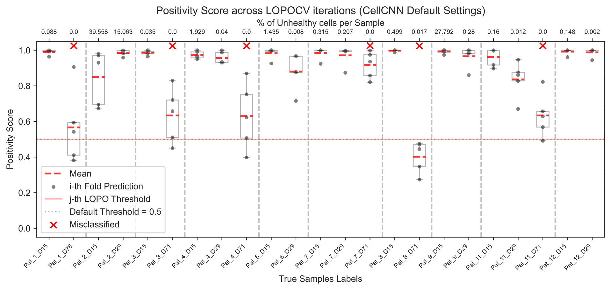
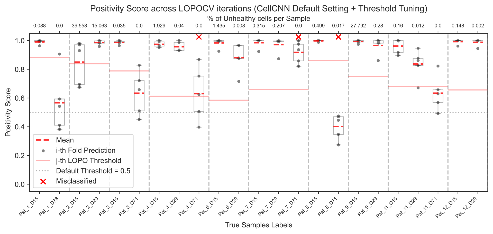
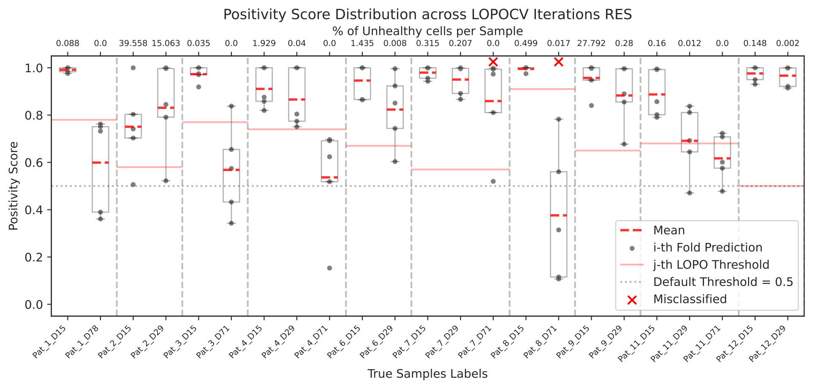

# Detecting Measurable Residual Disease in B-cell Acute Lymphoblastic Leukaemia using Convolutional Neural Networks

> ⚠️ **Project Status: Work in Progress (WIP)**
> 
> Welcome! This repository contains the code developed for my Master's Thesis, which is currently undergoing a major expansion. 
> 
> To keep the development organized, this repository is split into two main branches:
> * **[`thesis-version` branch](https://github.com/enricodidoli-source/BinCellCNN/tree/thesis-version)**: Contains the exact, finalized code presented for my graduation.
> * **`main` branch (Current)**: Contains the modularized and ongoing experimental work. 
>
> **[Click here to see all code differences between the Thesis version and the Current version](https://github.com/enricodidoli-source/BinCellCNN/compare/thesis-version...main)**.


---

## Roadmap & Current Implementations

- **Code Cleanup:** Ongoing removal of remaining debug, print statements and codebase readability refinement.
- **Uncertainty Quantification using Bayesian Statistics**
- **Cell-Level Analysis:** Implementation and integration of the full cell-level classification pipeline.

---

## Overview

This repository contains the code developed for my Master's thesis on **Measurable Residual Disease (MRD) detection** in B-cell Acute Lymphoblastic Leukaemia (B-ALL) using the **BinCellCNN** neural network architecture applied to multiparameter flow cytometry (MFC) data.

**BinCellCNN** is a specialized version of **CellCNN**, model developed by eiriniar. This extension is intended to work as a rare-event detection binary classifier (that's why "Bin" in the model name) rather then subpopolation detector.

Main modifications:
- Mandatory passing of validation set
- Elaboration of data as groups (avoids data leakage in case of correlation within samples doe to same patient)
- Possibility to use different metrics for Early stopping (CellCNN default metric is Accuracy)
- Grid search enabling
- Prediction of an entire sample instead of a subset
- Random reproducibility
- Allows the use of RAM management for limited hardwares

In addition to these modfications, the repository proposes a Research pipeline based on the Leave-One-Group-Out Cross-Validation approach that explores:
- Bayesian Optimization employed to optimize the choice of data augmentation parameters and batch-size.
- Training set up using the tuned parameters and increased number of epochs iterations implementing k-fold CV and several weights initializations for robust results.
- Classification threshold tuning using validation folds.
- Prediction and Classification of the held-out sets showing results in a comprehensive boxplot to analyse model prediciton confidence.

Finally, a pipeline usable in real-world clinical (or not) applications:
- Tuning and Training pipeline notebook with model weights saving
- Prediction and Classification pipeline notebook that restores the training weigths to return a classification label to a never seen sample.

A structured usable guide is going to be released to prepare the set-up for real applications. Stay Tuned!

---

The different settings were compared across Leave-One-Patient-Out Cross-Validation (LOPOCV):

- **CellCNN Default:** Uses the baseline variable values from the original CellCNN setup with a fixed classification threshold of `0.5`.
- **CellCNN Default + Threshold Tuning:** Uses the same baseline configuration, but tunes the classification threshold on validation folds by maximizing the F1-score.
- **Thesis Settings:** The approach developed in my Master's Thesis, which predicts multiple subsets per sample, aggregates their predictions, and performs threshold tuning.





> **Methodological note:** These comparisons reflect the practical evolution of the pipeline and codebase refactoring rather than a strict model comparison. In addition to changes in sample-level inference and threshold tuning, the settings differ in data augmentation parameters (such as `ncell` and `nsubset`).

---


## Repository Structure
 
```
BinCellCNN/
│
├── notebooks/                # Jupyter notebooks for experiments and results
│   ├── clinical/
│   ├── research/
│   ├── results_elaboration_and_plotting/
│   ├── training_classification/
│   ├── generate_synthetic_data.ipynb # Notebook used to generate the synthetic data
│   └── refactoring_single_cell_detection.ipynb
│
├── src/                      
│   ├── BinCellCNN/           # BinCellCNN Python modules (.py) (based on https://github.com/eiriniar/CellCnn)
│   ├── cell_level/           # Cell-level Python modules (.py)
│   ├── sample_level/         # Sample-level Python modules (.py) 
│   ├── shared/               # Python modules (.py) that both Cell-level and Sample-level share
│   ├── anything_else.py      # Any function still to be refactored
│   ├── ball_dataset.py       # Functions specific to the real-world dataset used
│   └── clinical.py           # Clinical application functions
│
├── Data/		      # Contains synthetic datasets and labels. Required for the practical implementation guide (see below)
│   ├── art_new_samples/      
│   │	└── samples_labels/    
│   └── art_train_samples/
│   	└── samples_labels/  
│
├── experiments/	      # Contains clinical and research base folders and their respective config.yml files. Necessary for practical implementation guide (see below)
│   ├── experiment_End_to_End_pipeline/ # All results from the research pipelines are saved here
│   │	└── config.yml
│   └── experiment_clinical/
│   	├── train_clinical_config.yml
│   	└── test_clinical_config.yml
│
├── .gitignore
├── README.md
└── requirements.txt
```

---
 
## Getting Started
 
### 1. Clone the repository
 
```bash
git clone https://github.com/enricodidoli-source/BinCellCNN.git
cd BinCellCNN
```
 
### 2. Install dependencies
 
```bash
pip install -r requirements.txt
```
> **Note:** To run these notebooks you need to preprocess your dataset and divide them into specific folders. A practical guide is going to be released.

### 3. Prepare your data

Follow the [data preparation guide](Data/Data_README.md).

### 4. Run the pipelines

- **Research pipeline** (LOPOCV): see the [research guide](experiments/Exp_README.md#research-pipeline)
- **Clinical pipeline** (training + classification of new samples): see the [clinical guide](experiments/Exp_README.md#clinical-pipeline)

> **Note:** Experiments were run on Google Colab with a CPU runtime due to budget constraints.
> A GPU runtime is recommended to reduce computation time.

---
 
## Dependencies

| Library | Version |
|---|---|
| NumPy | `>=1.26.0` |
| Pandas | `>=2.2.0` |
| SciPy | `>=1.14.0` |
| Scikit-learn | `>=1.5.0` |
| TensorFlow | `>=2.20.0` |
| Keras | `>=3.11.0` |
| FlowIO | `>=1.4.0` |
| Matplotlib | `>=3.9.0` |
| Seaborn | `>=0.13.0` |
| Optuna | `>=3.6.0` |
 
Install all dependencies with:
 
```bash
pip install -r requirements.txt
```
 
---

📁 **Experiments, results and plots** are available on Google Drive: https://drive.google.com/drive/folders/1JshP_PXYHC2fsba1stgj6rr7_iF3zJu2?usp=sharing  

---
> **Note:** Experiments were run on Google Colab using a CPU-based runtime due to budget constraints. Switching to a GPU runtime is possible and recommended to reduce computation time.
 